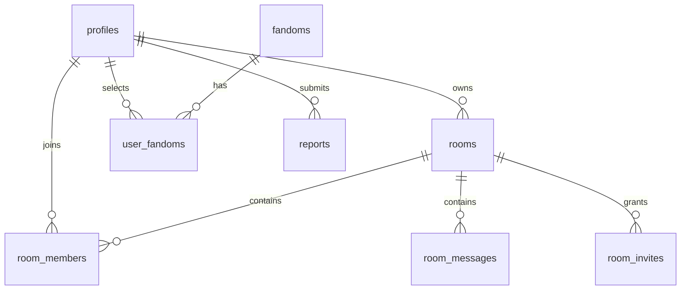

# Модель данных

> Русский · [[docs/en/Data Model|English]]

## Реализовано

Ключ katsodi.workspace.v1: rooms (UUID, name, description, format, visibility, url, art, createdAt UTC, kind=local), saved (IDs), followed (IDs). Схемы: src/lib/rooms.ts, workspace-provider.tsx. До 100 черновиков. Локаль — отдельный katsodi.locale. Каталог 150 фандомов — src/lib/fandoms.ts.

## Серверная модель — подключение есть, полная приёмка ещё впереди

profiles связана с auth.users; fandoms и user_fandoms; fandom_submissions; friend_requests, friendships с нормализованной уникальной парой; user_blocks; rooms, room_members, room_invites, room_messages, room_events; reports и moderation_actions.

В миграциях реализованы profiles, fandoms, user_fandoms, rooms, room_members, room_invites, room_messages: UUID, timestamptz UTC, FK, индексы, RLS и ограниченные GRANT. Создание owner+room и профиль+интересы атомарны. Invite token хранится только как SHA-256; redeem блокирует invite/room строки. Остальные таблицы на диаграмме — будущие этапы. [[docs/Features/Server Authorization]].

Media-миграция добавляет room_messages.kind, sticker_id, image_path/image_width/image_height/image_bytes и CHECK на согласованность типа. Изображения хранятся отдельно в приватном Storage bucket chat-images. Уникальный image_path не допускает повторной публикации одного объекта. Эта миграция пока не применялась агентом в облаке — [[docs/Features/Chat Media]].

## Связанные заметки
- [[docs/Architecture]]
- [[docs/Security and Privacy]]
