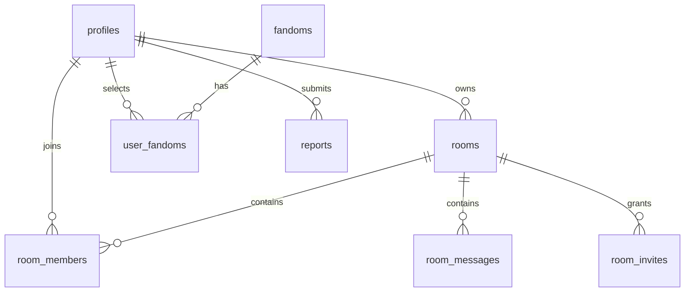

# Data Model

> English · [[docs/Data Model|Russian original]]

## Implemented

The katsodi.workspace.v1 key contains rooms (UUID, name, description, format, visibility, url, art, createdAt UTC, kind=local), saved IDs and followed IDs. Schemas: src/lib/rooms.ts and workspace-provider.tsx. Up to 100 drafts. Locale uses a separate katsodi.locale key. The 150-fandom catalogue is in src/lib/fandoms.ts.

## Server model: connected, full acceptance still pending

profiles relates to auth.users; fandoms and user_fandoms; fandom_submissions; friend_requests and friendships with a normalized unique pair; user_blocks; rooms, room_members, room_invites, room_messages and room_events; reports and moderation_actions.

Migrations implement profiles, fandoms, user_fandoms, rooms, room_members, room_invites and room_messages with UUIDs, UTC timestamptz, foreign keys, indexes, RLS and restricted GRANTs. Owner-plus-room and profile-plus-interests creation are atomic. Invite tokens are stored only as SHA-256; redemption locks invitation/room rows. Other tables on the diagram belong to future phases. [[docs/en/Features/Server Authorization]].

The media migration adds room_messages.kind, sticker_id, image_path/image_width/image_height/image_bytes and CHECK constraints for type consistency. Images are stored separately in the private chat-images Storage bucket. Unique image_path prevents publishing the same object twice. The agent has not applied this migration in the cloud — [[docs/en/Features/Chat Media]].

## Related notes

- [[docs/en/Architecture]]
- [[docs/en/Security and Privacy]]
